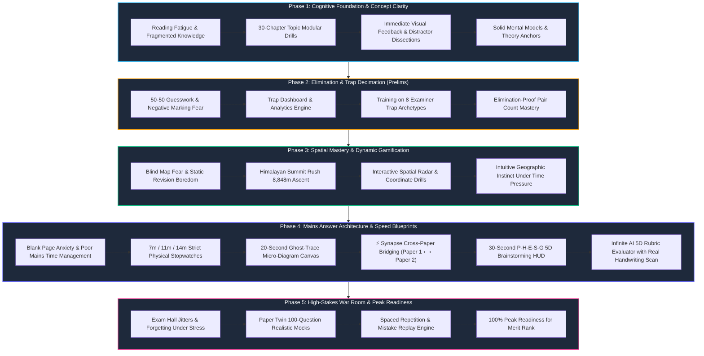

# 🗺️ TAYAARI: The Ultimate UPSC & State PSC Geography Mastery Engine
### *The Next-Generation Practice Platform for FAANG-Grade Speed, Pedagogical Rigor, and Rank-Securing Answer Writing*

---

## 🌟 Welcome, Aspirant!

Preparing for the **UPSC Civil Services Examination** and **State Public Service Commissions (BPSC, UPPCS, MPPSC, RAS)** is not just a test of what you read; it is a test of **how fast you can retrieve, analyze, synthesize, and visually communicate complex geographic reality under intense exam hall pressure**.

Most aspirants read standard textbooks (NCERT, Savindra Singh, Majid Husain, D.R. Khullar, GC Leong) multiple times, yet stumble when faced with:
1. **The 50–50 Prelims Dilemma**: Falling into deliberately engineered examiner traps (*Extreme Words, Attribute Swaps, Inverted Causations*).
2. **Modern Elimination-Proof Questions**: The new UPSC format (*"Only one pair / Only two pairs / All three / None"*).
3. **Mains Content Paralysis**: Knowing the theoretical concepts (Weber, Davis, Penck, Christaller), but struggling to structure a 250-word answer in 11 minutes or link Paper 1 theories to Paper 2 Indian spatial realities.
4. **Diagram Phobia**: Wanting to draw diagrams but taking 3–4 minutes, eventually abandoning diagrams and losing the crucial **+2 to +3 marks per question** that decide the final merit list.

**Tayaari** was designed from the ground up by combining the pedagogical wisdom of **top UPSC paper setters and chief evaluators** with **FAANG-grade interaction design (ex-Netflix cinematic themes, Apple Vision Pro fluid glassmorphism, Google Material You 3 spring physics)** to solve these exact bottlenecks.

---

## 🚀 The Aspirant’s 5-Phase Journey: How Tayaari Guides You to Rank 1

Below is the complete visual roadmap of an aspirant's preparation lifecycle and how each engine of the Tayaari app empowers you at every stage:

---

## 🎯 Exam-Wise Dedicated User Manual: How to Use Tayaari for Your Goal

Select your exam track below to discover the exact step-by-step method to maximize your score using the app:

---

### Track 1: UPSC Civil Services Examination (CSE) — Prelims (GS Paper I)

> **Exam Objective**: Score 110+ in GS Paper I by conquering the 20–25 high-yield Geography & Environment questions without negative marking.

#### 📌 Recommended Daily Routine in Tayaari:
1. **Step 1: Module-Wise Topic Drilling (Morning 30 Minutes)**
   * Open the app and head to **"Topic Selection"**.
   * Pick your target chapter from the **30-Chapter Curriculum** (e.g., *Chapter 12: Indian Climate & Monsoon* or *Chapter 7: Oceanography*).
   * Filter by **Tier (Basic $\rightarrow$ Medium $\rightarrow$ Hard)** and **Format (Statement-Based, Pair-Count, Assertion-Reason)**.
   * Solve 15–20 questions. When you select an option, the app instantly reveals:
     * 🟢 **Green / 🔴 Red immediate visual validation**.
     * **Distractor Dissection**: Detailed breakdown explaining *why* the wrong choices were designed as traps.
     * **Ranker's Memory Lock**: A high-retention 1-line formula to cement the concept forever.

2. **Step 2: Enter "Himalayan Summit Rush" Gamified Mode (Afternoon 15 Minutes)**
   * Toggle the **Summit Rush** button on the practice screen.
   * Watch your Altitude Meter climb from **Sea Level (0m) $\rightarrow$ Base Camp (5,364m) $\rightarrow$ South Col (7,900m) $\rightarrow$ Everest Peak (8,848m)**.
   * Every correct answer propels your avatar upwards with electric pulse feedback, building healthy speed pressure without anxiety.

3. **Step 3: Analyze Traps on the Trap Dashboard (Evening 10 Minutes)**
   * Open the **Trap Dashboard** from the bottom bar.
   * See your personalized radar chart categorizing where you lose negative marks:
     * *Absolute Extremes Trap* ("always", "never", "only").
     * *Subtle Conceptual Inversion* (e.g., Davis slope decline vs Penck slope replacement).
     * *Chronological / Spatial Reversal* (North-to-South river order, stratigraphic horizon sequence).
   * Tap on your weakest trap category to launch a targeted **10-Question Trap Training Session**.

4. **Step 4: Spaced Repetition Replay (Night 10 Minutes Before Bed)**
   * Open **"Mistake Replay"**.
   * Review all questions bookmarked or missed over the last 3 days. Once answered correctly twice across spaced intervals, the app marks the item as **Permanently Mastered**.

---

### Track 2: UPSC Civil Services Examination (CSE) — Mains (GS 1 & Optional Paper I & II)

> **Exam Objective**: Break through the 300+ mark ceiling in Geography Optional and 110+ in GS 1 by mastering rapid diagram sketching, theoretical interlinkages, and 5-dimensional structured answers.

#### 📌 Step-by-Step Mains Architecture Protocol:
1. **Step 1: Launch the "Mains Answer Architect"**
   * On the dashboard, tap the prominent card: **"🏛️ Mains Answer Architect"**.
   * Cycle through curated flagship questions using the bottom navigation:
     * `[ ◀ Previous Question ]` $\longleftrightarrow$ `Question X of 5` $\longleftrightarrow$ `[ Next Question ▶ ]`.
   * Questions represent real UPSC high-yield themes:
     * *Weber's Least Cost Theory & Indian Industrial Spatial Shifts* (20M/300W/14m)
     * *Taylor Neo-Determinism vs Possibilism & Planetary Boundaries* (15M/250W/11m)
     * *Davis vs Penck Geomorphic Cycle & Slope Evolution* (15M/250W/11m)
     * *Coupled ENSO-IOD Monsoon Teleconnections* (15M/250W/11m)
     * *Comparative Landslide Vulnerability: Himalayas vs Western Ghats* (10M/150W/7m)

2. **Step 2: Activate the 30-Second P-H-E-S-G HUD (Brainstorming Phase)**
   * Tap **"P-H-E-S-G"** on the quick-action bar.
   * Never run out of answer points by systematically covering the 5 dimensions required by UPSC Chief Examiners:
     * **P (Physical)**: Geomorphic, lithological, climatic, hydrological drivers.
     * **H (Human)**: Demographic shifts, settlement geography, cultural adaptation.
     * **E (Economic)**: Industrial linkages, raw material index, trade routes, energy costs.
     * **S (Spatial)**: Location maps, latitudinal gradients, port proximity, regional disparity.
     * **G (Governance)**: Policy frameworks, NDMA guidelines, NITI Aayog schemes, COP goals.
   * Tap each dimension chip as you draft your outline.

3. **Step 3: Master the 20-Second "Ghost-Trace" Micro-Diagram Canvas**
   * Tap **"📐 20s Diagram"**.
   * A translucent vector blueprint appears on screen (e.g., *Weberian Locational Triangle & Critical Isodapane*, *ENSO Pacific Walker Cell*, or *Penck Slope Triad*).
   * Tap **"Start 20s Sprint"**:
     * Stroke 1 (4s): Outer geometry / base bounds.
     * Stroke 2 (5s): Core vectors and flows.
     * Stroke 3 (6s): Annotated labels and theoretical thresholds.
     * Stroke 4 (5s): Legend and evaluative title.
   * ⚠️ **Mandatory Physical Paper Protocol**: The app explicitly mandates picking up an actual 0.7mm blue/black ballpoint pen and replicating the blueprint on unruled physical paper before the timer hits 0. This builds real physical motor memory for the exam hall!

4. **Step 4: Unlock the ⚡ Synapse Cross-Paper Bridge**
   * Tap **"⚡ Synapse"**.
   * See the golden formula linking **Paper 1 Theory** directly to **Paper 2 Indian Empirical Reality**:
     * *Example*: Linking *Alfred Weber’s Least Cost Theory & D.M. Smith’s Spatial Margins* (Paper 1) to the *Coastal Migration of Indian Steel Plants (AM/NS Hazira, POSCO Paradip) and Sugar Mill Migration to Maharashtra* (Paper 2).
     * Includes ready-to-write Topper Quote Formulas and empirical case studies.

5. **Step 5: Infinite Chief Evaluator 5D Rubric Evaluation**
   * Write your complete answer on paper or type key structural bullets into the text console.
   * Tap **"🚀 Submit for Chief Examiner Evaluation"**.
   * The AI Chief Examiner evaluates your submission infinitely against the official 5-dimensional rubric:
     * 1️⃣ **Directive Adherence & Focus** (Did you "Critically Analyze" or just "Describe"?)
     * 2️⃣ **Paper 1 ⟷ Paper 2 Synaptic Interlinkage** (Did you quote theoretical anchors?)
     * 3️⃣ **Micro-Diagram Quality & Spatial Precision** (Did you include a 20s schematic?)
     * 4️⃣ **Empirical Case Studies & Real-World Facts** (Did you cite specific Indian regions?)
     * 5️⃣ **Structural Flow & P-H-E-S-G Multiplier** (Did you present balanced multi-dimensional points?)
   * Receive a color-coded scorecard: 🟢 Strong Points, 🟡 Improvements Needed, 🔴 Critical Omissions, plus your **Topper Percentile Band** (e.g. *88th Percentile — Top 10% Mains Quality*).
   * Tap **"Re-attempt"** to re-write and score higher, or **"Reveal Model Solution"** to read the master model answer with the 30-second micro-structure blueprint.

---

### Track 3: State Public Service Commissions (BPSC, UPPCS, MPPSC, RAS)

> **Exam Objective**: Ace both analytical conceptual geography and regional state-specific geography with maximum speed.

#### 📌 State PCS Strategic Method:
1. **Dedicated State Modules (e.g. Bihar Geography — Chapter 23)**:
   * Access 62 dedicated BPSC/UPSC questions covering:
     * *Shiwalik Range & Dun Valley physiography*.
     * *North vs South Gangetic Drainage (Kosi, Gandak, Son, Punpun, Falgu)*.
     * *Agro-Climatic Zones (Zone I NW, Zone II NE, Zone IIIA SW, Zone IIIB SE)*.
     * *Soils (Terai, Balasundar, Karail-Kewal, Tal soils)*.
     * *Valmiki Tiger Reserve, Kabartal Ramsar Site, and Pyrite/Mineral deposits of Rohtas*.
2. **Speed-Accuracy Practice**:
   * State PCS papers feature high question density (150 questions in 120 minutes).
   * Practice in **Untimed Mode** first to master concepts, then switch to **Timed Mock Mode** to hit a target of **35–45 seconds per question**.
3. **Assertion-Reasoning Mastery**:
   * Filter questions by **"Assertion-Reason"** format to practice resolving cause-and-effect questions frequently asked in UPPCS and BPSC Prelims.

---

### Track 4: CDS, NDA, CAPF (AC) & Allied UPSC Exams

> **Exam Objective**: Master conceptual physical geography (Geomorphology, Climatology, Oceanography) and direct map-based questions.

#### 📌 Allied Exams Method:
1. **Focus on Core Physical Geography**:
   * Prioritize **Chapters 1 to 7** (*Earth's Interior, Plate Tectonics, Landforms, Atmosphere, Ocean Currents, and Planetary Winds*).
   * These chapters constitute over 70% of geography questions in CDS and CAPF (AC).
2. **Map & Chokepoint Drills**:
   * Practice **Chapter 22 (World Regional Geography)** and **Chapter 9 (India Location & Borders)** to master:
     * *Global maritime chokepoints (Strait of Hormuz, Malacca, Bab-el-Mandeb, Bosphorus)*.
     * *Standard Meridian, Tropic of Cancer states, and Island channels (10°, 9°, 8° Channels, Duncan Passage)*.
3. **Rapid Revision Mode**:
   * Use **"Smart Revision"** to run through 50 random physical geography MCQs before your exam.

---

## 🛠️ Feature Reference Guide

| Feature | Where to Find It | What It Does for You |
|:---|:---|:---|
| **🏛️ Mains Answer Architect** | Topic Screen $\rightarrow$ Top Card | Comprehensive Mains descriptive practice with stopwatches, diagrams, and evaluation. |
| **📐 20s Ghost-Trace Canvas** | Mains Screen $\rightarrow$ Quick Actions | Stroke-by-stroke 20-second diagram drawing blueprints with countdown timer. |
| **⚡ Synapse Cross-Paper Bridge** | Mains Screen $\rightarrow$ Quick Actions | Explicit linkage formula pairing Paper 1 models with Paper 2 Indian geography. |
| **🏔️ Himalayan Summit Rush** | Practice Screen $\rightarrow$ Game Toggle | Visual altitude ascent from 0m to 8,848m rewarding consecutive correct answers. |
| **📊 Trap Dashboard** | Main Dashboard $\rightarrow$ Trap Icon | Analyzes your psychological pitfalls (Absolute traps, subtle inversions, swapped pairs). |
| **🔁 Mistake Replay** | Main Dashboard $\rightarrow$ Insights | Spaced repetition queue that stores your errors until you conquer them twice. |
| **📄 Paper Twin Mock Engine** | Main Dashboard $\rightarrow$ Paper Twin | Simulates 100-question full-length authentic UPSC Prelims papers. |
| **☁️ Zero-Disk RAM Engine** | Built-in Core Architecture | Streams questions on-demand into memory; keeps 0 SQLite rows on disk, taking <45MB RAM. |

---

## 📅 Recommended 60-Day Study Schedule with Tayaari

* **Morning (07:00 – 07:45)**: 20 Questions from the current module on Tayaari (Target: 80%+ accuracy).
* **Afternoon (14:00 – 14:30)**: 1 Mains Question in **Mains Answer Architect** (7m for 10M or 11m for 15M; replicate diagram on paper).
* **Evening (19:00 – 19:20)**: 15-Minute session in **Himalayan Summit Rush** to test retrieval speed.
* **Night (22:00 – 22:15)**: **Mistake Replay** to clear all pending revision items before sleep.

---

## 📥 App Installation & Cloud OTA Updates

* **APK Download URL**: [`app-debug.apk`](https://raw.githubusercontent.com/CODE-ops-stack/my-new-ready-app/main/app-debug.apk) (34.0 MB)
* **Direct High-Speed CDN Feed**:
  * Manifest: `https://cdn.jsdelivr.net/gh/CODE-ops-stack/my-new-ready-app@main/topics/manifest.json`
  * Metadata: `https://cdn.jsdelivr.net/gh/CODE-ops-stack/my-new-ready-app@main/metadata.json`
  * Questions: `https://cdn.jsdelivr.net/gh/CODE-ops-stack/my-new-ready-app@main/questions.json`
* **OTA Auto-Update**: The app features a background Over-The-Air (OTA) engine. Whenever question revisions, new Mains blueprints, or APK updates are published to the cloud repository, the app checks `metadata.json` on resume and automatically updates content without losing your bookmarks or progress.
* **Zero Storage Bloat**: All questions and blueprints stream live via high-speed CDN edge nodes into volatile device RAM. Your phone's internal storage remains clean and light.

---

*“Success in UPSC is not about knowing everything under the sun; it is about remembering the right framework, avoiding the examiner’s trap, and expressing the spatial truth clearly within limited time.”*

**All the best for your preparation! 🇮🇳 Jai Hind.**
